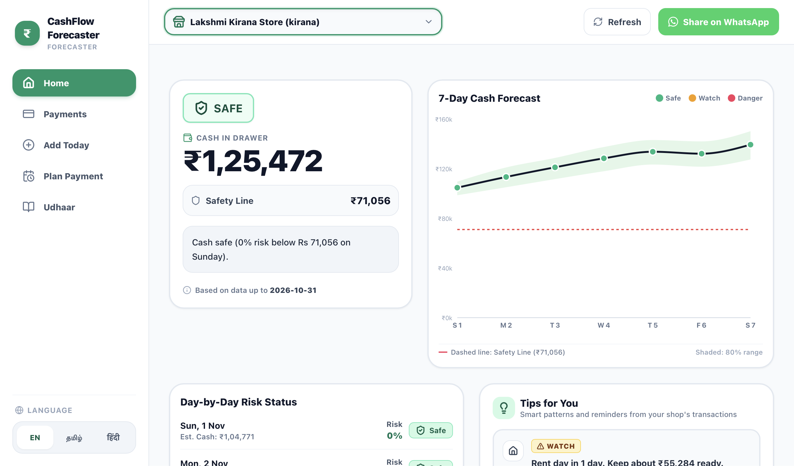
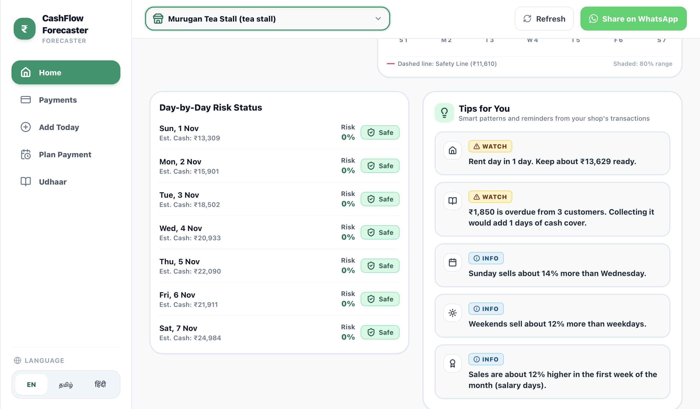
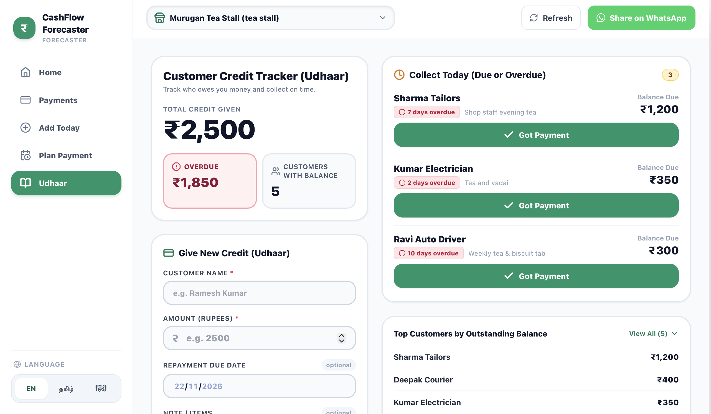
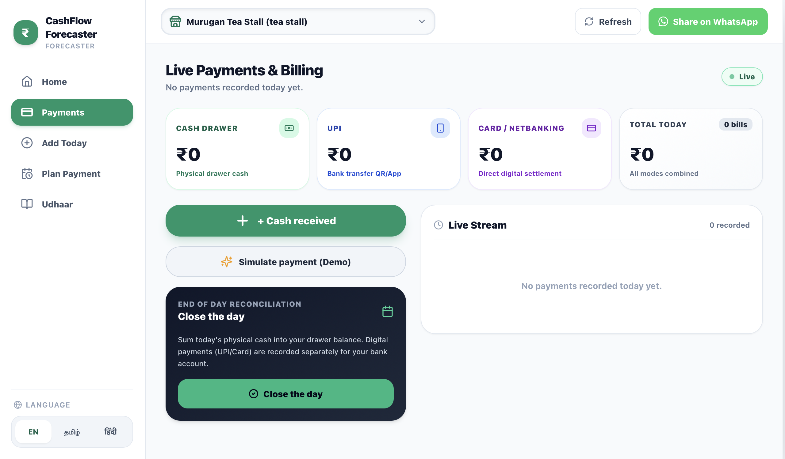
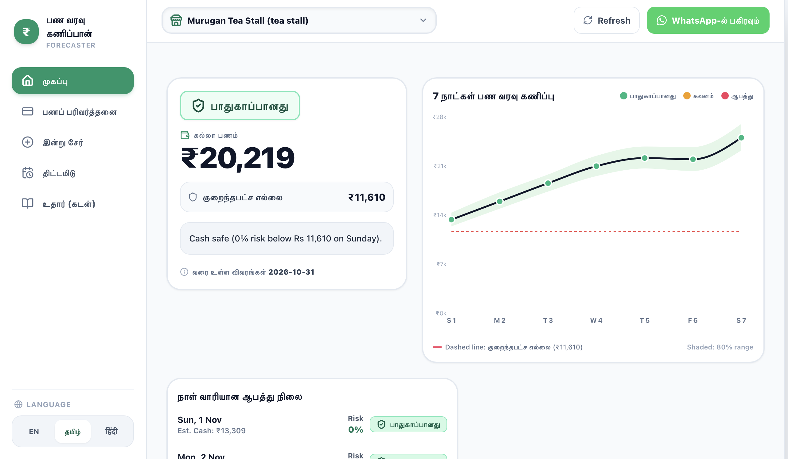
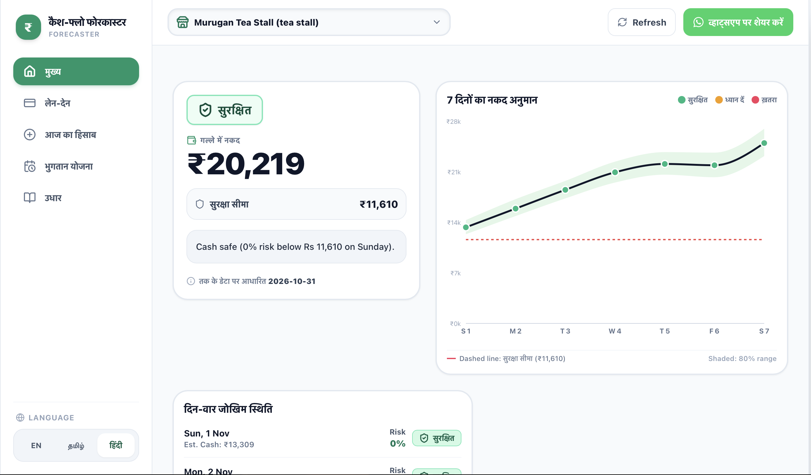
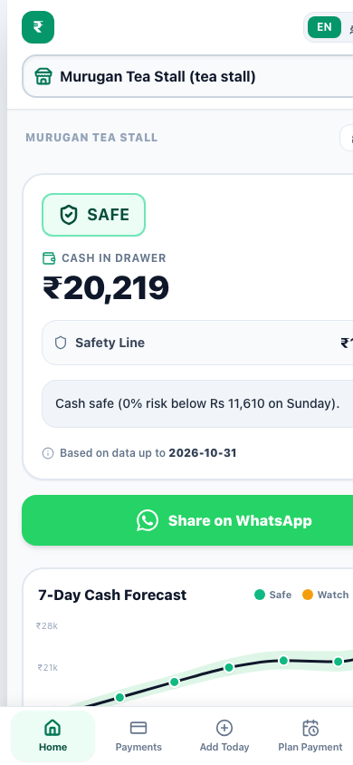
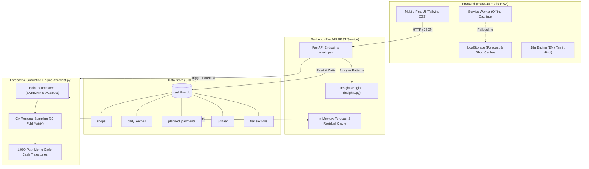

# Daily Cash-Flow Forecaster for Small Businesses

> An early-warning cash flow forecasting and liquidity management Progressive Web App (PWA) designed for non-technical neighborhood shop owners (kirana stores, tea stalls, tiffin centers, vegetable marts) to predict cash shortages 7 days in advance.

[](https://cashflow-forecaster-three.vercel.app)
[](https://cashflow-forecaster-backend.onrender.com/health)
[](https://opensource.org/licenses/MIT)

**Live Demo URL**: [https://cashflow-forecaster-three.vercel.app](https://cashflow-forecaster-three.vercel.app)  
> *Note: The backend runs on a free Render tier and may take up to a minute to wake up on the first visit. The application will automatically show a "Waking up the server..." message and retry.*

---

## What It Does

1. **Forecasts 7 Days Ahead**: Predicts upcoming daily cash sales and drawer cash balances using machine-learning time-series models trained on daily cash drawer accounting.
2. **Issues Early Risk Alerts**: Translates probabilistic cash trajectories into accessible color-coded alert levels (**Safe**, **Watch**, **Danger**) with explicit percentage probabilities of falling below minimum safety thresholds.
3. **Simulates "What-If" Payment Scenarios**: Allows shopkeepers to test prospective supplier bills or personal withdrawals before spending cash, computing the safest day of the week to pay and calculating the maximum safe payment amount (`max_safe_amount`).
4. **Tracks Customer Credit (*Udhaar*)**: Maintains an active ledger of informal credit, flagging overdue accounts, prioritizing daily collections, and calculating how many days of cash cover recovered credit would provide.
5. **Provides Plain-Language Business Insights**: Surfaces automated business tips (weekend boosts, salary week surges, upcoming rent countdowns, expense spikes) in everyday conversational language across **English**, **Tamil (தமிழ்)**, and **Hindi (हिंदी)**.
6. **Tracks Live Payments & Cash Reconciliation**: Live counter transaction feed for physical cash and digital channels (UPI, card, netbanking) with instant numeric keypad logging, flash highlights on arrival, a 10-minute undo window, and end-of-day drawer reconciliation.

---

## Features

- **Probabilistic Risk Alerts**: Unlike single-point forecasts that hide uncertainty, the engine simulates 1,000 empirical cash trajectories to calculate the true mathematical risk of dropping below the safety line.
- **Live Payments & Cash Register Stream**:
  - Real-time stream polling every 5s with background pause (`document.visibilityState`) and arrival flash highlights.
  - Quick-entry numeric keypad with +₹10, +₹50, +₹100, +₹500 chips for 1-tap cash logging.
  - 10-minute undo protection for shopkeepers to fix mistaken manual cash entries.
  - End-of-day register closeout that reconciles physical drawer cash while keeping digital collections segregated for bank settlement.
- **Interactive "What-If" Planner**:
  - Automatically identifies whether an expenditure is `ok`, if a `better_day_exists`, or if the amount is `too_large` for the entire week.
  - Dynamically calculates `max_safe_amount` (the highest multiple of ₹1,000 up to the current cash balance that keeps peak 7-day risk under 20%).
- **Customer Credit (*Udhaar*) Recovery Queue**:
  - Instant recording of credit given and partial/full collections.
  - "Collect Today" priority queue sorted by largest outstanding balances.
  - Automatic status transition from `open` to `closed` when debts are settled.
- **Automated Business Insights**:
  - Highlights top-selling vs. slowest weekdays.
  - Compares weekend vs. weekday sales volume.
  - Detects first-week-of-the-month salary influxes.
  - Proactively warns of upcoming rent deadlines 5 days in advance with estimated capital requirements.
- **One-Click WhatsApp Share**: Generates a compact, URL-encoded summary strictly under 400 characters formatted with Indian numbering (`₹1,25,472`) and localized in the shopkeeper's active language for sharing with family or business partners.
- **Multilingual Support**: Fully localized in English, தமிழ் (Tamil), and हिंदी (Hindi) with zero-reload dynamic switching.
- **Progressive Web App (PWA) with Offline Fallback**:
  - Pre-cached application shell opens instantly on mobile devices.
  - Seamless fallback to `localStorage` when offline or during backend cold-starts, showing an `"Offline - showing last saved forecast (<date>)"` banner.
  - Supports "Add to Home Screen" on iOS Safari and Android Chrome, as well as "Add to Dock" on macOS.
- **Responsive: Phone and Desktop**:
  - **Phone (< 768px)**: Centered mobile layout with large 56px touch targets, fixed bottom navigation bar, and accessible high-contrast cards.
  - **Tablet & Desktop (md >= 768px, lg >= 1024px, xl >= 1280px)**: Scales smoothly up to `max-w-7xl` container. Features a 240px left sidebar (logo, 4 nav items, language toggle), a top bar across the content area (shop selector, refresh, WhatsApp share), a 2-column Home dashboard (5/12 cash meter, 7/12 taller 360px forecast chart, side-by-side risk list and tips), a 2-column Udhaar manager, 2-column What-If planner, and desktop 44px controls with hover states and keyboard focus rings.
- **Accessible Design**: Color-blind friendly icon cues (Checkmark, Triangle, Octagon paired with labels), high-contrast styling, and Indian currency formatting (`₹1,25,472`).

---

## Screenshots

| Screen | Preview | Description |
| :--- | :---: | :--- |
| **Home Dashboard** |  | Cash meter with safety line, 7-day probabilistic forecast chart, day-by-day risk alerts, and automated tips. |
| **What-If Planner** |  | Scenario planner testing prospective expenses, finding the safest day to pay, and calculating max safe amount. |
| **Udhaar Credit Tracker** |  | Customer credit ledger with overdue status alerts and priority "Collect Today" recovery queue. |
| **Live Payments & Register** |  | Real-time counter feed, 1-tap numeric cash keypad, 10-minute undo, and cash vs. bank day reconciliation. |
| **Tamil Localization** |  | Full application localization in conversational Tamil (தமிழ்) with one-click language switching. |
| **Hindi Localization** |  | Complete interface localization in everyday Hindi (हिंदी) with zero-reload dynamic toggling. |
| **WhatsApp Share** |  | One-click formatted WhatsApp status update under 400 characters ready to share with partners or family. |
| **Mobile PWA Experience** |  | Mobile-first responsive layout with 56px touch targets, fixed bottom navigation bar, and offline support. |

---

## Architecture



### Cash Accounting Identity
All cash movements strictly adhere to the daily drawer identity:
$$\text{closing\_cash}_t = \text{closing\_cash}_{t-1} + \text{cash\_sales}_t + \text{udhaar\_collected}_t - \text{expenses}_t - \text{owner\_withdrawal}_t - \text{unplanned\_outflow}_t$$

The server guarantees this identity: shopkeepers only log transaction activity, and closing cash balances are automatically calculated and cascaded across subsequent days.

---

## Live Payments & Daily Register Reconciliation

The **Payments** tab provides small merchants with a real-time counter register that tracks both physical cash and digital sales:

1. **4 Live Summary Cards**: Displays today's collections across **Cash Drawer**, **UPI**, **Card / Netbanking**, and **Total Received**, with a dynamic subtitle indicating the time elapsed since the last transaction (*e.g., "Last payment 4 min ago"*).
2. **Instant Numeric Keypad**: Designed for speedy counter checkout with big touch buttons and quick-add chips (+₹10, +₹50, +₹100, +₹500) for 1-tap cash entry.
3. **Live Streaming & Arrival Highlights**: Polls the backend every 5 seconds using `GET /shops/{id}/transactions?since=`. Automatically pauses when the browser tab is hidden to conserve bandwidth and battery. When a payment arrives, the row flashes with a green highlight.
4. **10-Minute Cash Undo**: Allows shop owners to immediately undo mistaken manual cash entries within 10 minutes directly from the counter feed.
5. **Close the Business Day**: One-tap reconciliation modal with an explicit accounting breakdown.

> [!NOTE]
> **Honest Note on Phase A**: The payment stream currently supports manual cash registration, instant counter feed updates, and simulated digital (UPI, Card, Netbanking) payments for testing and customer demonstrations. Real UPI dynamic QR code generation and direct payment gateway webhooks (e.g., Razorpay/Paymate/Cashfree) are scheduled for Phase B.
> 
> **Accounting Rule**: Only physical cash transactions alter `closing_cash` in the till drawer. Digital transactions (UPI, cards, netbanking) are tracked in `daily_entries.digital_sales` and routed directly to the merchant's bank account, preventing artificial inflation of till cash.

---

## Experimental Results

### 1. 7-Day Ahead Forecast Model Benchmark (10-Fold TimeSeriesSplit)

We evaluated four model families across 730 days of transactions for four representative micro-business types:

| Shop Type | Model | MAE (₹) | MAE Std | MAPE (%) | MAPE Std | Winner |
| :--- | :--- | :---: | :---: | :---: | :---: | :---: |
| **tea_stall** | Moving Average | ₹805.43 | ₹491.65 | 15.13% | 6.19% | |
| | Seasonal Naive | ₹904.89 | ₹486.04 | 17.13% | 6.67% | |
| | SARIMAX | ₹551.00 | ₹192.00 | 10.73% | 3.42% | |
| | **XGBoost** | **₹512.36** | **₹131.23** | **9.86%** | **2.46%** | **Best (Lowest MAPE)** |
| **vegetable_shop** | Moving Average | ₹2,475.24 | ₹1,083.91 | 19.91% | 7.28% | |
| | Seasonal Naive | ₹2,251.91 | ₹1,068.42 | 18.36% | 6.21% | |
| | SARIMAX | ₹1,473.15 | ₹501.38 | 12.23% | 2.57% | |
| | **XGBoost** | **₹1,320.47** | **₹403.39** | **10.70%** | **2.87%** | **Best (Lowest MAPE)** |
| **tiffin_center** | Moving Average | ₹2,752.37 | ₹2,026.63 | 17.22% | 8.48% | |
| | Seasonal Naive | ₹3,151.50 | ₹1,964.70 | 19.99% | 8.43% | |
| | **SARIMAX** | **₹1,583.47** | **₹417.34** | **10.46%** | **2.09%** | **Best (Lowest MAPE)** |
| | XGBoost | ₹1,630.19 | ₹536.20 | 10.48% | 2.36% | |
| **kirana** | Moving Average | ₹4,126.77 | ₹3,052.84 | 18.31% | 8.41% | |
| | Seasonal Naive | ₹4,450.91 | ₹3,127.74 | 19.95% | 9.93% | |
| | **SARIMAX** | **₹2,697.81** | **₹450.47** | **12.45%** | **2.69%** | **Best (Lowest MAPE)** |
| | XGBoost | ₹2,955.11 | ₹1,422.35 | 12.89% | 3.62% | |

*(Source: `reports/model_comparison.csv`)*

### 2. Three-Setting 52-Week Alert Backtest Comparison

To determine what risk can actually be predicted versus what requires owner communication, we ran a rolling 52-week backtest across three operational settings:
- **Setting A (As-is)**: Ground truth is actual closing cash falling below threshold. The model has no knowledge of owner withdrawals.
- **Setting B (Forecastable-only)**: Ground truth counterfactually removes owner withdrawals and unplanned outflows, measuring alerts against sales/expense swings alone.
- **Setting C (Owner-informed)**: Actual owner withdrawals are entered into the system in advance as planned payments.

| Shop Type | Setting | Crises | Alerts | True Positives | False Positives | Precision | Recall |
| :--- | :--- | :---: | :---: | :---: | :---: | :---: | :---: |
| **tea_stall** | A (As-is) | 17 | 4 | 4 | 0 | 100.0% | 23.5% |
| | B (Forecastable-only) | 4 | 4 | 4 | 0 | 100.0% | 100.0% |
| | C (Owner-informed) | 17 | 18 | 15 | 3 | 83.3% | 88.2% |
| **vegetable_shop** | A (As-is) | 11 | 6 | 5 | 1 | 83.3% | 45.5% |
| | B (Forecastable-only) | 4 | 6 | 4 | 2 | 66.7% | 100.0% |
| | C (Owner-informed) | 11 | 6 | 5 | 1 | 83.3% | 45.5% |
| **tiffin_center** | A (As-is) | 16 | 1 | 1 | 0 | 100.0% | 6.2% |
| | B (Forecastable-only) | 0 | 1 | 0 | 1 | 0.0% | 0.0% |
| | C (Owner-informed) | 16 | 17 | 15 | 2 | 88.2% | 93.8% |
| **kirana** | A (As-is) | 9 | 13 | 9 | 4 | 69.2% | 100.0% |
| | B (Forecastable-only) | 8 | 13 | 8 | 5 | 61.5% | 100.0% |
| | C (Owner-informed) | 9 | 13 | 9 | 4 | 69.2% | 100.0% |

*(Source: `reports/alert_backtest_v2.csv`)*

### Honest Observations on Model Results
- **ARIMA vs. XGBoost Parity**: SARIMAX and XGBoost are roughly tied in accuracy (~10–12% MAPE). XGBoost slightly edges out on smaller shops with sharp non-linear holiday spikes (`tea_stall`, `vegetable_shop`), while SARIMAX performs slightly better on linear autoregressive series (`kirana`, `tiffin_center`).
- **Sample Size Limitation**: The evaluation utilized 10 cross-validation folds on a 7-day forecast horizon (70 evaluated horizon days per shop). While sufficient for benchmark comparisons, real-world deployment would require continuous rolling telemetry.
- **The Role of Owner Information**: In the `tiffin_center`, **100% of Setting A cash crises** were triggered by unannounced owner cash withdrawals. Pure sales forecasting only achieved a 6.2% recall in Setting A; once the owner entered their known withdrawal plans (Setting C), recall surged to **93.8%**. Cash-flow risk engines cannot replace owner communication.

---

## Limitations and Honesty

1. **Synthetic Data**: All data was generated algorithmically based on empirical micro-retail dynamics (monsoon seasonality, Diwali/Pongal surges, weekend shifts, and wholesale cycles). It does not reflect a live bank account feed.
2. **Unforecastable Cash Outflows**: Personal withdrawals and emergency repair expenses cannot be predicted from sales history. The model depends on the owner utilizing the planned payment / what-if tool to register upcoming outflows.
3. **Interval Calibration Variations**: While empirical coverage was near nominal for `tea_stall` (78.8%), `tiffin_center` (72.8%), and `kirana` (72.5%) for the 80% p10–p90 band, it was somewhat overconfident for `vegetable_shop` (66.2%) due to high inventory purchase volatility.
4. **Demo Data Horizon**: The bundled seed dataset covers November 1, 2024 through **October 31, 2026**.

---

## How to Run Locally

### Prerequisites
- Python 3.10+ (tested on Python 3.11 and 3.14)
- Node.js 18+ and npm

### 1. Backend Setup

```bash
# Clone the repository
git clone https://github.com/your-username/cashflow-forecaster.git
cd cashflow-forecaster

# Create and activate Python virtual environment
python -m venv .venv
source .venv/bin/activate  # On Windows: .venv\Scripts\activate

# Install dependencies
pip install -r requirements.txt

# Seed the database with demo shops and 365 days of entries
python app/backend/seed.py

# Start the FastAPI server
uvicorn app.backend.main:app --reload --host 127.0.0.1 --port 8000
```
The API is available at `http://127.0.0.1:8000` (interactive documentation at `http://127.0.0.1:8000/docs`).

### 2. Frontend Setup

In a new terminal window:
```bash
cd app/frontend
npm install
npm run dev
```
Open `http://localhost:5173` in your browser.

### 3. Running Automated Tests

To run the complete backend integration and regression test suite (25 tests):
```bash
source .venv/bin/activate
pytest tests/test_api.py -v
```

To build and verify the frontend Progressive Web App:
```bash
cd app/frontend
npm run build
```

---

## Deployment Guide

### Backend on Render (Free Web Service)
1. Fork or push this repository to GitHub.
2. In Render, create a new **Web Service** or use the included blueprint [`render.yaml`](file:///Users/jayadevygmail.com/cashflow-forecaster/render.yaml):
   - **Runtime**: Python 3
   - **Build Command**: `pip install -r requirements-backend.txt`
   - **Start Command**: `uvicorn app.backend.main:app --host 0.0.0.0 --port $PORT`
   - **Health Check Path**: `/health`
3. **Environment Variables**:
   - `CORS_ORIGINS`: `https://cashflow-forecaster-three.vercel.app,http://localhost:5173`
   - `PYTHON_VERSION`: `3.11.9`
4. The service automatically seeds the 4 demo shops and historical data on startup if the database is uninitialized.

### Frontend on Vercel
1. In Vercel, import the repository and set **Root Directory** to `app/frontend`.
2. **Framework Preset**: Vite.
3. **Build Command**: `npm run build` | **Output Directory**: `dist`.
4. **Environment Variables**:
   - `VITE_API_URL`: Your deployed Render backend URL (e.g. `https://cashflow-forecaster-backend.onrender.com`).
5. Client-side routes and PWA service workers are handled by [`app/frontend/vercel.json`](file:///Users/jayadevygmail.com/cashflow-forecaster/app/frontend/vercel.json).

---

## Tech Stack

| Layer | Technologies |
| :--- | :--- |
| **Frontend Framework** | React 18, Vite |
| **Styling & Icons** | Tailwind CSS, Lucide React |
| **Charts & Visualization** | Recharts (ResponsiveContainer, AreaChart, ReferenceLine) |
| **PWA & Offline** | `vite-plugin-pwa`, Workbox, Service Worker, Web App Manifest |
| **Backend API** | FastAPI, Uvicorn, Pydantic v2 |
| **Time-Series Forecasting** | Statsmodels (`SARIMAX`), XGBoost (`XGBRegressor`) |
| **Machine Learning & Math** | Scikit-learn (`TimeSeriesSplit`), NumPy, Pandas |
| **Database** | SQLite 3 (`cashflow.db`) with Foreign Keys & Cascading Deletes |
| **Testing** | Pytest, HTTPX, FastAPI TestClient |
| **Hosting & CI/CD** | Render (Backend API), Vercel (Frontend PWA) |

---

## License

This project is licensed under the MIT License - see the [LICENSE](LICENSE) file for details.
